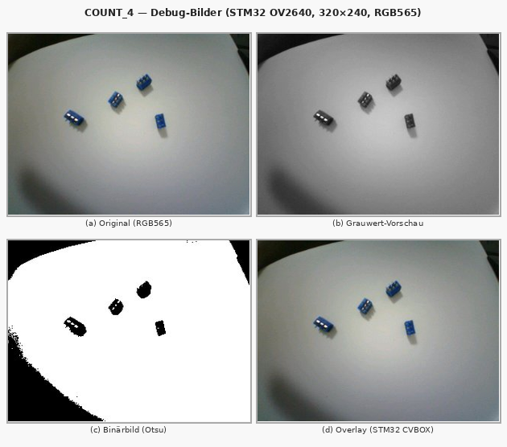
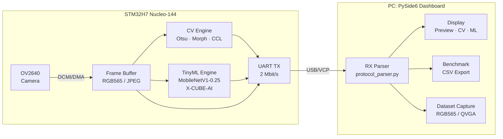

# STM32 Edge Vision: Object Counting with Classical CV and TinyML

Object counting on an **STM32H743ZI** with an **OV2640** camera. The same camera frame is evaluated in two ways, and both run on the microcontroller:

- **Classical image processing:** threshold (Otsu or manual), morphology and connected components
- **TinyML:** a quantised MobileNetV1-0.25 that classifies the frame into 0 to 4 objects, deployed with X-CUBE-AI

A PC dashboard (PySide6) sends the commands, shows the results, runs benchmarks and records images for the dataset. It does no image processing itself.

The firmware is written in C on FreeRTOS: camera capture over DCMI and DMA, the image processing pipeline, the TinyML integration and a UART protocol at 2 Mbit/s.

Course project *Mechatronik und Robotik 2* in the M.Sc. Mechatronics and Robotics at Frankfurt UAS (summer semester 2026, grade 1.0).

## Results

Run times and memory, measured on the board with the firmware after the code review (Nucleo-144 board with STM32H743ZI at 480 MHz, 320×240 RGB565 frame, `HAL_GetTick()` with 1 ms resolution, firmware built with Arm GNU Toolchain 14.2, `-Os`). Each value is the mean of five consecutive runs on a scene (spread at most 1 ms). The CV rows give the range over the scenes measured (a dark one, a bright one and a few more).

| Operation | Time |
|---|---|
| Classical CV, Otsu, preset FAST (no filter, no morphology) | 37 to 55 ms |
| Classical CV, Otsu, preset ROBUST (3×3 box filter, 3×3 opening) | 161 to 166 ms |
| Classical CV, Otsu, preset ACCURATE (5×5 median, 5×5 opening) | 551 to 704 ms |
| TinyML inference (MobileNetV1-0.25) | 53 ms |

The CV time depends on the scene (by up to 30 %), the TinyML time does not. The TinyML activation buffer is in DTCM; in the non-cacheable RAM_D3 an inference took 157 ms. TinyML footprint including the runtime: ≈ 279 KiB flash and ≈ 57 KiB RAM.



*Debug views of one test frame with four objects: (a) original frame, (b) grayscale, (c) Otsu binary image computed in the dashboard, (d) overlay view of the frame from the STM32.*

## System architecture



## Hardware setup

| Part | Details |
|------|---------|
| MCU board | STM32H743ZI, Nucleo-144 |
| Camera | OV2640, connected via DCMI + DMA |
| UART | USART3 → ST-LINK VCP, **2 000 000 Baud, 8N1** |
| LED (heartbeat) | Red LED PB14, 1 Hz blink = firmware running |
| Push button | PC13, manual snapshot trigger |

**Memory layout**

| Region | Size | Content |
|--------|------|---------|
| RAM_D1 | 512 KB | Frame buffer (255 KB) + CV binary buffer (128 KB) |
| RAM_D2 | 288 KB | CV temp buffer (128 KB) + CV background buffer (128 KB) |
| DTCM | 128 KB | TinyML activation buffer (40 KB), heap and main stack |
| Flash | 2 MB | X-CUBE-AI runtime + network: 285,355 B (≈ 279 KiB), of which weights 219,844 B (214.7 KiB) |

## Quick start: GUI

```bash
# 1. Create virtual environment
python -m venv .venv
.venv\Scripts\activate          # Windows
source .venv/bin/activate       # Linux / macOS

# 2. Install dependencies
pip install -r requirements.txt

# 3. Run the dashboard
python GUI_App/app/src/main.py
```

Connect to the correct COM port at **2 000 000 Baud**.  
The "STM32 ready" indicator appears after `OV2640 ready` is received.

**Basic workflow**

| Step | GUI action | UART command |
|------|-----------|--------------|
| 1 | Mode = RGB → **SNAP** | `MODE RGB` + `SNAP` |
| 2 | **Run STM32 CV** | `CV RUN` |
| 3 | **Run STM32 TinyML** | `TM RUN` |
| 4 | Set GT Count → **Add Run** | - |
| 5 | **Export CSV** | - |

> CV RUN and TM RUN always operate on the **last captured** RGB565 frame.

## Documentation

| Topic | File |
|---|---|
| Model, dataset capture and training | [docs/training.md](docs/training.md) |
| Image processing pipeline, deployment with X-CUBE-AI, benchmarking | [docs/firmware.md](docs/firmware.md) |
| UART protocol between the STM32 and the PC | [docs/uart-protocol.md](docs/uart-protocol.md) |
| Troubleshooting and Python dependencies | [docs/troubleshooting.md](docs/troubleshooting.md) |

## Known limitations

- **Run times: a few scenes, one build.** The table in *Results* comes from a GCC build made without CubeMX (see below) and the scenes the camera happened to see. A build made in STM32CubeIDE was not measured. Most of the CV time is spent in memory that the MPU marks as non-cacheable (RAM_D1 and RAM_D2); making RAM_D2 cacheable was tried, shortened the CV time by about 15 %, but made the TinyML result constant, so it was not kept.
- **Code review and board test.** The project's own source files were read (firmware in `Core/Src`, the dashboard in `GUI_App/app/src`, the scripts in `ML training/src`); the code generated by ST (HAL, FreeRTOS, X-CUBE-AI) and the Qt layout file were not. The review found and fixed these errors, each checked on a Nucleo-144 board:
  - Otsu score overflowed in `uint64_t` and the threshold was off by one. For a test frame the old firmware used threshold 254 where the corrected code gives 94; the pixel count of the old firmware (one scene) and of the corrected firmware (two scenes) matched my Python model of the respective version exactly.
  - Protocol lines longer than 191 characters (`CVCFG`) were cut without a line break.
  - `SNAP` with the flash LED, the register lists of the camera driver and the capture loop kept UART_TX and the heartbeat from running (busy-waiting in a higher-priority task). The effect itself (blocked output) was not measured; the functions behave as before (all frame sizes, JPEG stream 13.8 frames/s).
  - A background reference was still used after the ROI or the resolution had changed.
  - `MODE` and `RES` reset the sensor, so brightness, contrast, saturation, effect and white balance fell back to the defaults while the dashboard still showed the old values.
  - `RES VGA` in RGB mode left the camera application in a state where every `SNAP` failed.
  - Every manual `SNAP` in RGB mode reset the quality settings of the dashboard.

  Two behaviours are documented but not changed: `ZOOM 2|4` only scales the whole field of view down, and `AWB 0` is the sensor's other automatic mode, not "off" (see [docs/uart-protocol.md](docs/uart-protocol.md)). The tests used a build made without CubeMX (GCC 14.2, the generated X-CUBE-AI validation files replaced by empty functions), not a CubeIDE build.
- **TinyML accuracy is a rough figure.** 82.4 % on 250 validation images that also selected the checkpoint; the validation curve is noisy (see [docs/training.md](docs/training.md)). Two very dark test frames (mean grey 3 and 38) were both classified as `count_4` with 99.6 %, so the model does not signal an unusual input.

## Repository structure

```text
Machine-Vision-on-Microcontrollers/
│
├─ GUI_App/                              # PySide6 Reference Dashboard
│  └─ app/
│     ├─ src/
│     │  ├─ main.py                      # Qt application entry point
│     │  ├─ reference_window.py          # Main controller (6 mixins)
│     │  ├─ protocol_parser.py           # STM32 UART protocol parser
│     │  ├─ serial_service.py            # QSerialPort wrapper
│     │  ├─ image_utils.py               # JPEG / RGB565 / GRAY conversion
│     │  ├─ dashboard_controller.py      # Serial + camera mode (DashboardMixin)
│     │  ├─ rx_controller.py             # UART RX path, frame decode (RxMixin)
│     │  ├─ display_controller.py        # Preview refresh, CV/ML labels (DisplayMixin)
│     │  ├─ bench_controller.py          # Benchmark table, CSV export (BenchMixin)
│     │  ├─ save_controller.py           # Frame/log save (SaveMixin)
│     │  ├─ dataset_controller.py        # Automated dataset capture (DatasetMixin)
│     │  ├─ app_constants.py             # Constants, stylesheet
│     │  └─ app_helpers.py               # Path helpers, FrameTransfer, norm01
│     ├─ ui/
│     │  └─ reference_window.ui          # Qt Designer layout
│     └─ assets/
│        └─ app_icon.ico
│
├─ CubeIDE_Workspace/
│  └─ STM32_H7Firmware/                  # STM32CubeIDE project
│     ├─ Core/
│     │  ├─ Src/
│     │  │  ├─ main.c                    # Buffer alloc, MPU, task creation
│     │  │  ├─ camera_app.c/.h           # UART command handler, FreeRTOS tasks
│     │  │  ├─ camera_capture.c/.h       # DCMI/DMA frame capture
│     │  │  ├─ camera_proto.c/.h         # UART protocol formatters
│     │  │  ├─ camera_parse.c/.h         # Command parser
│     │  │  ├─ cv_engine.c/.h            # CV pipeline (7 stages)
│     │  │  ├─ tinyml_engine.c/.h        # X-CUBE-AI inference wrapper
│     │  │  ├─ tinyml_preprocess.c/.h    # RGB565 → uint8 96×96 tensor
│     │  │  ├─ uart_tx.c/.h              # Non-blocking DMA UART TX
│     │  │  └─ ov2640_Drive.c/.h         # OV2640 camera driver
│     │  └─ Inc/                         # Corresponding header files
│     └─ X-CUBE-AI/                      # Generated by STM32CubeMX (Target/ and validation files are not in the repo)
│        └─ App/
│           ├─ network.c/.h              # Generated AI network kernel
│           ├─ network_data.c/.h         # Model weights (Flash)
│           ├─ network_data_params.c/.h  # Weight parameters
│           ├─ network_config.h          # Network configuration
│           ├─ network_generate_report.txt # X-CUBE-AI analysis report
│           └─ app_x-cube-ai.c/.h        # Integration layer
│
├─ ML training/                          # PC-side TinyML workflow
│  ├─ dataset/                           # git-ignored, keep locally
│  │  ├─ train/ count_0…count_4/         # ≥ 100 images per class
│  │  └─ val/   count_0…count_4/         # ≥ 20 images per class
│  ├─ src/
│  │  ├─ train_count_model.py            # Standalone Keras CNN script (alternative to the Model Zoo run)
│  │  ├─ predict_count_tflite.py         # PC-side TFLite verification + hash check
│  │  └─ check_dataset.py                # Dataset structure validator
│  └─ Model/
│     ├─ user_config.yaml                # ST Model Zoo training config
│     └─ 2026_06_27_20_08_38/            # Training run that is flashed on the board
│        ├─ Training_curves.png          # Loss / accuracy curves
│        ├─ logs/metrics/train_metrics.csv
│        └─ quantized_models/quantized_model.tflite   # ← deployed model (304,216 B ≈ 297 KiB; the weights alone are 214.7 KiB)
│
├─ requirements.txt                      # Unified Python dependencies
└─ README.md
```

## Contributors

| Name | Role |
|------|------|
| Mutasem Bader | STM32 firmware (FreeRTOS, DCMI/DMA, CV engine, TinyML integration, UART protocol), ML training pipeline, measurements, system integration |

## License

Copyright (c) 2026 Mutasem Bader. All rights reserved.
Viewing is permitted. Copying, modifying, or submitting as own work is strictly prohibited.
See [LICENSE](LICENSE) for details.
