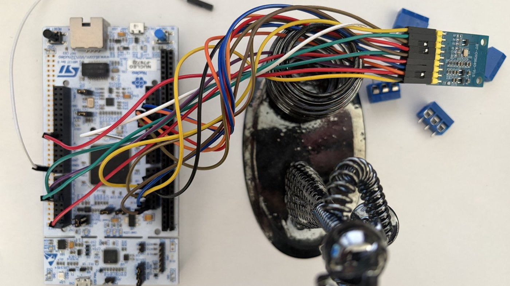

# STM32 Edge Vision: counting objects with classical CV and TinyML

The firmware of a camera system on an STM32H743 that counts up to four objects in an image. The same frame is evaluated in two ways, both on the microcontroller itself: with classical image processing (threshold, morphology, connected components) and with a small quantised neural network (MobileNetV1-0.25, deployed with X-CUBE-AI). The firmware is the main part of this repository. A PC dashboard, which was built with the help of an AI assistant, sends the commands, shows the results and the timing, and records images for the training dataset.

Course project in the M.Sc. Mechatronics and Robotics at Frankfurt UAS.



*The setup: a Nucleo-144 board, the OV2640 camera module on jumper wires and some of the screw terminals that the model counts.*

## The firmware

The firmware is written in C on FreeRTOS. The camera (OV2640) sends its frames over DCMI and DMA into a buffer, and the CV engine and the TinyML engine both work on that buffer, so they see exactly the same pixels. Commands come in and results and frames go out over USART3 (the ST-LINK virtual COM port) at 2 Mbit/s. There are four tasks: a heartbeat, a UART transmit task with a queue, the command task that also runs the CV engine and the network, and a stream task for continuous JPEG frames. [docs/firmware.md](docs/firmware.md) describes the architecture, the CV pipeline and the commands, and [docs/uart-protocol.md](docs/uart-protocol.md) the protocol.

The dashboard only displays what the board sends; it does no image processing for the results. It also has a benchmark table in which every run can be saved with the true count and exported as CSV.

## Results

Measured on the board (Nucleo-144, STM32H743ZI at 480 MHz, 320×240 RGB565 frame, `HAL_GetTick()` with 1 ms resolution, built with Arm GNU Toolchain 14.2 and `-Os`). Each value is the mean of five runs on one scene, and the spread was at most 1 ms. For the CV rows the range over the scenes tried is given (a dark one, a bright one and a few more).

| Operation | Time |
|---|---|
| Classical CV, Otsu, preset FAST (no filter, no morphology) | 37 to 55 ms |
| Classical CV, Otsu, preset ROBUST (3×3 box filter, 3×3 opening) | 161 to 166 ms |
| Classical CV, Otsu, preset ACCURATE (5×5 median, 5×5 opening) | 551 to 704 ms |
| TinyML inference | 53 ms |

The CV time depends on the scene by up to 30 %, the TinyML time does not. Most of the CV time goes into memory that the MPU marks as non-cacheable. The TinyML activation buffer sits in DTCM; in the non-cacheable RAM_D3 one inference took 157 ms.

For memory, the TinyML part needs about 279 KiB of flash (214.7 KiB of that are the weights) and 57 KiB of RAM, including the X-CUBE-AI runtime. The frame buffer (255 KB) and the CV binary buffer (128 KB) are in RAM_D1, the CV temporary and background buffers (128 KB each) in RAM_D2.

The network was trained on 480×272 images of blue screw terminals, 0 to 4 per image. On its 250 validation images the quantised model reaches 82.0 % (the Model Zoo reports 82.4 %). More on that in [docs/training.md](docs/training.md).


*One test frame with four objects: (a) the original frame, (b) grayscale, (c) the Otsu binary image computed in the dashboard, (d) the overlay from the STM32.*

## What does not work well

- The TinyML model only knows the training scene. For anything else (a room, a black image, noise) it answers `count_0` or `count_4` with about 99 %, so such a count means nothing. A test on the board with real terminals in front of the camera has still to be done.
- After about 5 of 16 starts in one test period the TinyML result was wrong until the next reset, and the cause was not found. It did not come back afterwards. The firmware now checks the network with two fixed inputs at every start.
- The run times come from a GCC build made without CubeMX and from the few scenes the camera happened to see. A build made in STM32CubeIDE was not measured.

The errors that were found and fixed while testing on the board are listed in [docs/test-notes.md](docs/test-notes.md).

## Build and run

**Firmware.** Open `CubeIDE_Workspace/STM32_H7Firmware/STM32_H7Firmware.ioc` in STM32CubeMX and click Generate Code once after cloning, because the X-CUBE-AI target files are generated and not part of the repository. Then build and flash with STM32CubeIDE. [docs/firmware.md](docs/firmware.md) has the details.

**Dashboard.**

```bash
python -m venv .venv
.venv\Scripts\activate          # Windows
source .venv/bin/activate       # Linux, macOS
pip install -r requirements.txt
python GUI_App/app/src/main.py
```

Connect to the COM port of the board at 2 000 000 baud. The controls are enabled when `OV2640 ready` arrives. A typical run: set the mode to RGB and press SNAP, then Run STM32 CV and Run STM32 TinyML (both work on the last captured RGB frame), enter the true count, press Add Run, and export the table as CSV at the end.

**Training.** The model was trained with the ST Model Zoo; see [docs/training.md](docs/training.md).

## What is where, and where it comes from

- `CubeIDE_Workspace/STM32_H7Firmware/`: the firmware. The files written for this project are in `Core/Src` and `Core/Inc`: the camera application and tasks, the command parser, the capture and the protocol code, `cv_engine`, `tinyml_engine`, `tinyml_preprocess` and `uart_tx`. `X-CUBE-AI/` is generated by STM32CubeMX.
- `ov2640_Drive.*` and `ov2640_regs.*` (the OV2640 driver and its register lists) were taken from code found on the Internet and modified for this project. The STM32 HAL, CMSIS, FreeRTOS and the X-CUBE-AI runtime are the libraries of their vendors. Details and licenses are in [THIRD-PARTY-NOTICES.md](THIRD-PARTY-NOTICES.md).
- `GUI_App/`: the dashboard, built with the help of an AI assistant.
- `ml_training/`: the Model Zoo configuration, the training run that is flashed on the board, and `src/evaluate.py`, which runs the quantised model on the dataset and prints the accuracy and the confusion matrix. The dataset is not in the repository.
- `docs/`: [training](docs/training.md), [firmware](docs/firmware.md), [UART protocol](docs/uart-protocol.md), [troubleshooting](docs/troubleshooting.md), [test notes](docs/test-notes.md).

AI assistants were also used for code review, for some fixes in the firmware and for the documentation.

## License

Copyright (c) 2026 Mutasem Bader. All rights reserved.
Viewing is permitted. Copying, modifying, or submitting as own work is strictly prohibited.
See [LICENSE](LICENSE) for details.
