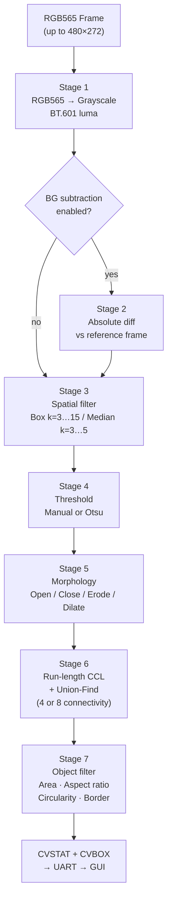
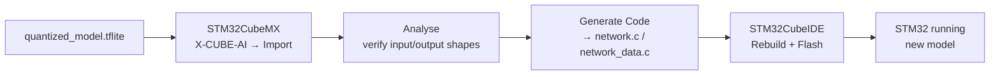

# Firmware: image processing, deployment and benchmarking

Back to the [README](../README.md).

## CV pipeline



**CV command reference**

| Command | Effect |
|---------|--------|
| `CV RUN` | Run full pipeline on last RGB565 frame |
| `CV GET` | Send current config (CVCFG) |
| `CV EN 0\|1` | Disable / enable CV engine |
| `CV PRESET 0..3` | CUSTOM / FAST / ROBUST / ACCURATE |
| `CV THRMODE 0\|1` | Manual / Otsu auto-threshold |
| `CV THR 0..255` | Manual threshold value |
| `CV INV 0\|1` | Invert binary image |
| `CV FILTER 0..2` | OFF / BOX / MEDIAN |
| `CV BLUR 0..7` | Pre-threshold blur kernel (0=off, 1→3×3 … 7→15×15) |
| `CV MORPHMODE 0..4` | OFF / OPEN / CLOSE / ERODE / DILATE |
| `CV MORPH 0..7` | Morphology kernel size |
| `CV CON 4\|8` | CCL connectivity |
| `CV MINAREA n` | Minimum object area (px²) |
| `CV MAXAREA n` | Maximum object area (0=unlimited) |
| `CV ASPECT min max` | Aspect ratio filter (×1000) |
| `CV CIRC min` | Circularity minimum (×1000, edge-count based metric) |
| `CV BGCAP` | Capture current frame as background (for the current frame size and ROI; `CV RUN` discards it with a warning when either has changed) |
| `CV BGSUB 0\|1` | Enable background subtraction |
| `CV BORDFILT 0\|1` | Reject large blobs touching the border (≥ 85 % of width/height or ≥ 35 % of the area) |
| `CV ROI 1 x y w h` | Set region of interest |
| `CV ROI 0` | Disable ROI |

## STM32 deployment (X-CUBE-AI)

### Building the firmware from a fresh clone (mandatory step)

Not all X-CUBE-AI files are in the repository: `X-CUBE-AI/Target/` and the validation files in `X-CUBE-AI/App/` (e.g. `aiValidation.*`, `ai_device_adaptor.*`) are git-ignored, but `app_x-cube-ai.c` includes `bsp_ai.h` and `aiValidation.h` and calls `MX_UARTx_Init()` / `aiValidationInit()`. A fresh clone therefore does **not** build without code generation:

1. After cloning, open `CubeIDE_Workspace/STM32_H7Firmware/STM32_H7Firmware.ioc` in STM32CubeMX and run **Generate Code** (the X-CUBE-AI Target and validation files are generated and are not in the repo).
2. Open the project in STM32CubeIDE, build and flash.

The `.ioc` refers to the model by a path starting with the placeholder `<repo-root>` (an experiments_outputs run folder that is not part of this repo). If CubeMX cannot find it, select `quantized_model.tflite` again in the X-CUBE-AI settings (see the steps below).

### Updating the model



1. Open **STM32CubeMX** → X-CUBE-AI → Import `quantized_model.tflite`.
2. Click **Analyse** and verify:
   - Input: `uint8(1×96×96×3)`, `QLinear(0.00784, 127)`
   - Output: `float32(1×5)`
   - Activations: **40.2 KiB**, Weights: **214.7 KiB**
3. **Generate Code** → rebuild in STM32CubeIDE.
4. `tinyml_engine.c` requires **no changes** after regeneration.

### X-CUBE-AI v10.2: two mandatory lines in `tinyml_init()`

```c
// 1. Initialise STAI runtime before any network call.
//    Without this, ai_network_run() always produces constant outputs.
stai_runtime_init();

// 2. Pass NULL for weights — ai_network_data_params_get() sets the
//    correct Flash pointer internally. Passing the weights table directly
//    overrides it with the wrong address.
ai_network_create_and_init(&g_network, activations, NULL);
```

## Benchmarking

For a **reproducible CV vs TinyML comparison**:

1. `SNAP`: capture one RGB565/QVGA frame.
2. `CV THRMODE 1` + `CV RUN`: Otsu auto-threshold (no manual tuning).
3. `TM RUN`: inference on the **same frame** (no new SNAP).
4. Set **GT Count** in the GUI → **Add Current Run**.
5. Repeat for scenes with 0, 1, 2, 3, 4 objects.
6. **Export CSV** → analyse accuracy, timing, uncertain predictions.

**Measured on the STM32H743 @ 480 MHz** (mean of five consecutive runs on one scene, `HAL_GetTick()`, 1 ms resolution; firmware built with Arm GNU Toolchain 14.2, `-Os`)

| Operation | Mean latency |
|-----------|--------------|
| CV RUN, Otsu, preset FAST (no filter, no morphology), QVGA | 55 ms |
| CV RUN, Otsu, preset ROBUST (3×3 box, 3×3 opening), QVGA | 161 ms |
| CV RUN, Otsu, preset ACCURATE (5×5 median, 5×5 opening), QVGA | 551 ms |
| TM RUN (inference) | 157 ms |

The spread between the five runs was at most 1 ms. The dependence on the scene was not checked.

