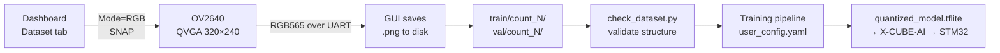

# Model, dataset and training

Back to the [README](../README.md).

## Model specification

| Field | Value |
|-------|-------|
| Architecture | MobileNetV1 α=0.25, depthwise separable convolutions |
| Input shape | **96 × 96 × 3** (H × W × C) |
| Colour space | **RGB** (3 channels) |
| Input dtype | **uint8 \[0…255\]** |
| Quantisation | Post-training, `QLinear(scale=1/127.5, zero_point=127)` |
| Output | float32 \[5\], Softmax probabilities |
| Classes | `count_0`, `count_1`, `count_2`, `count_3`, `count_4` |
| Parameters | 211,621 |
| MACC (ops) | **7,550,858** |
| Weights (Flash) | **219,844 B (214.7 KiB)** |
| Activations (RAM) | **41,152 B (40.2 KiB)** |
| Total Flash (incl. runtime) | **285,355 B (≈ 279 KiB)** |
| Total RAM (incl. runtime) | **57,876 B (≈ 57 KiB)** |
| Resize method | **Nearest-neighbour, full-frame stretch** (no padding, no letterbox), firmware: `tinyml_preprocess.c`; training: `aspect_ratio: fit` + `interpolation: nearest` |

### Preprocessing: firmware and training

The STM32 firmware (`tinyml_preprocess.c`) maps each pixel with integer-floor nearest-neighbour and stretches the full frame:

```c
sx = ox * src_width  / 96;   // integer floor — no rounding
sy = oy * src_height / 96;
```

The checked-in `ML training/Model/user_config.yaml` uses `interpolation: nearest`, `color_mode: rgb` and **`aspect_ratio: fit`**. In the ST Model Zoo, `fit` resizes the image to the target size and distorts it if the aspect ratio differs; it does **not** letterbox. The other valid values are `crop` (cropping) and `padding` (black borders); `stretch` is not a valid value. So `aspect_ratio: fit` in training corresponds to the full-frame stretch the firmware performs.

### Common misconfigurations

| Wrong value | Correct value | Impact |
|-------------|--------------|--------|
| `input_shape: (48, 48, 1)` | `(96, 96, 3)` | Wrong model size |
| `color_mode: grayscale` | `rgb` | 1-channel vs 3-channel mismatch |
| `aspect_ratio: crop` or `padding` | `fit` | Training sees cropped or bordered images, the chip stretches the full frame |
| `board: STM32H747I-DISCO` | `NUCLEO-H743ZI2` | Wrong benchmarking target |

## Training results

**Run:** `2026_06_27_20_08_38`, ST Model Zoo `chain_tqe` (train → quantise → evaluate). This is the model that is flashed on the board: a byte comparison of its weight tensors with `X-CUBE-AI/App/network_data_params.c` (four 24-byte windows per tensor) finds every window, and `network_generate_report.txt` names this run folder.

| Metric | Value |
|--------|-------|
| Accuracy of the float model on the validation set | **82.8 %** (207 of 250 images) |
| Accuracy of the quantised (uint8) model on the same set | **82.4 %** (206 of 250 images) |
| Best validation accuracy during training | 82.8 % (epoch 26; epoch 33 reached 80.4 %) |
| Validation accuracy in the last epoch | 70.8 % (epoch 46) |
| Median validation accuracy, epochs 20–46 | 72.4 % (range 65.6 % to 82.8 %) |
| Training accuracy, last epoch | 94.3 % (with augmentation) |
| Training epochs | 47 logged (0–46, up to 100 configured; early stopping, patience 20) |
| Training time | 996 s (21.2 s per epoch) |
| LR schedule | 1e-3 → 5e-4 (ep 35) → 2.5e-4 (ep 43) |
| Framework | TensorFlow 2 / Keras, ST Model Zoo |


> How to read these numbers: the validation accuracy jumps between epochs by up to 10 points, and 82.8 % is a single-epoch peak. `restore_best_weights: true` restores the weights of that epoch (the Model Zoo log reports 82.8 % for the float model, not the 70.8 % of the last epoch, so the restored weights were evaluated). The same 250 images chose the checkpoint and report the result, so 82.4 % is an optimistic estimate for new frames. All validation accuracies in `train_metrics.csv` are multiples of 1/250 (derived from the CSV; the dataset is not in the repo). The gap to the training accuracy (94.3 %) shows that the model overfits the small dataset.

> **Evaluation on the validation set** (`ML training/src/eval_quantized_numpy.py`, numpy only, 250 images): 82.0 % (the Model Zoo log says 82.4 %). Rows are the true class, columns the predicted one:
>
> | true \ predicted | 0 | 1 | 2 | 3 | 4 |
> |---|---|---|---|---|---|
> | 0 | 50 | 0 | 0 | 0 | 0 |
> | 1 | 0 | 45 | 5 | 0 | 0 |
> | 2 | 0 | 7 | 38 | 5 | 0 |
> | 3 | 0 | 0 | 5 | 29 | 16 |
> | 4 | 0 | 0 | 0 | 7 | 43 |
>
> On the first 60 training images per class the accuracy is 94.0 %. Variants of the validation images: RGB565 floor expansion as in the firmware 82.0 %, squeezed to 320×240 first 80.4 %, 30 % darker 79.6 %, 30 % brighter 76.0 %. The script is not bit-exact to the TFLite kernels; on six synthetic images it gave the same scores as the real runtime to three decimals.
> The images show blue screw terminals on a light background. For other scenes (a room, black, uniform or noisy images) the model answers `count_0` or `count_4` with about 99 %, so a count from such an image is meaningless.

> Training on real OV2640 frames captured with the Dataset Capture tool.  
> Training and firmware use the same preprocessing mode: full-frame stretch (`aspect_ratio: fit`), nearest-neighbour interpolation, RGB. The exact pixel mapping of TensorFlow's nearest resize and of the firmware's integer-floor mapping was not compared.

**X-CUBE-AI analysis summary** (`network_generate_report.txt`)

| Layer type | Count | % of MACC |
|------------|-------|-----------|
| Conv2D (14 standard incl. 1×1 pointwise + 13 depthwise) | 14 + 13 = 27 | 99.2 % |
| GlobalAvgPool + Dense + Softmax | 3 | 0.05 % |
| Input conversion (u8→s8) | 1 | 0.7 % |
| Output conversion (dequantise to float32) | 1 | < 0.01 % |

## Dataset capture workflow



1. Connect STM32 → GUI → Dataset tab.
2. Select **split** (`train` / `val`) and **label** (`count_0`…`count_4`).
3. Click **Capture N frames**. The GUI snaps and saves automatically.
4. Collect **≥ 100 training** and **≥ 20 validation** images per class (see `ML training/docs/DATASET_GUIDE.md`).
5. With "Force RGB / QVGA" ticked, the PNGs are 320×240 RGB (otherwise JPEG frames are saved). The dataset of the deployed model, however, consists of **480×272** PNGs (WQVGA) of blue screw terminals; the firmware stretches every frame to 96×96, so both sizes work, but 480×272 matches the training images. The dashboard's "Snap + TM RUN" therefore captures WQVGA.

## Quick start: ML training

```bash
# 1. Validate dataset
python "ML training/src/check_dataset.py" --root "ML training/dataset"

# 2. Edit ML training/Model/user_config.yaml
#    Replace the <path-to-dataset> placeholders (training_path, validation_path,
#    quantization_path) with the absolute path of your local dataset folder

# 3. Clone ST Model Zoo (once) and install its own requirements
#    (the Model Zoo has no setup.py/pyproject.toml, so "pip install -e" does not work;
#     use a separate virtual environment as described in the Model Zoo README -
#     its pinned versions, e.g. tensorflow, differ from this repo's requirements.txt)
cd "ML training/Model"
git clone https://github.com/STMicroelectronics/stm32ai-modelzoo-services --depth 1
cd stm32ai-modelzoo-services
pip install -r requirements.txt

# 4. Train + quantise (chain_tqe) - stm32ai_main.py is in image_classification/ (not in tf/)
#    --config-path is resolved relative to the folder of stm32ai_main.py:
#    ../.. = "ML training/Model" (where user_config.yaml is located). An absolute path also works.
cd image_classification
python stm32ai_main.py \
    --config-path ../.. \
    --config-name user_config.yaml
#    Output: image_classification/tf/src/experiments_outputs/<timestamp>/

# 5. Verify on PC (from the repository root; copy the run folder
#    experiments_outputs/<timestamp> to "ML training/Model/<timestamp>" first,
#    or point --model to the file in experiments_outputs)
python "ML training/src/predict_count_tflite.py" \
    --model "ML training/Model/2026_06_27_20_08_38/quantized_models/quantized_model.tflite" \
    --image path/to/frame.png \
    --show-hash
```

## Training workflow

### 1. Validate dataset

```bash
python "ML training/src/check_dataset.py" --root "ML training/dataset"
```

### 2. Configure `user_config.yaml`

```yaml
dataset:
  training_path:     "/abs/path/to/dataset/train"
  validation_path:   "/abs/path/to/dataset/val"
  quantization_path: "/abs/path/to/dataset/train"

preprocessing:
  resizing:
    interpolation: nearest
    aspect_ratio: fit        # full-frame stretch = same as the firmware ("stretch" is not a valid value)
  color_mode: rgb            # ← critical

model:
  model_name: mobilenetv1_a025

training:
  epochs: 100
  batch_size: 16
```

### 3. Train (ST Model Zoo)

```bash
cd "ML training/Model/stm32ai-modelzoo-services/image_classification"
python stm32ai_main.py \
    --config-path ../.. \
    --config-name user_config.yaml
```

`stm32ai_main.py` is located in `image_classification/` (not in `tf/`). Hydra resolves `--config-path` relative to the folder of `stm32ai_main.py`, so `../..` points to `ML training/Model` (where `user_config.yaml` is located); an absolute path works as well. The output folder comes from `hydra: run: dir:` in `user_config.yaml`, a path relative to the working directory. Started from `image_classification/`, the result is:

`image_classification/tf/src/experiments_outputs/<timestamp>/quantized_models/quantized_model.tflite`

### 4. Verify preprocessing parity on PC

```bash
python "ML training/src/predict_count_tflite.py" \
    --model "ML training/Model/2026_06_27_20_08_38/quantized_models/quantized_model.tflite" \
    --image path/to/frame.png --show-hash
```

Compare `hash=XXXXXXXX` with the STM32 log `TM_IN: hash=...`. Note: PNGs saved by the GUI expand RGB565 → RGB888 with rounding, the firmware uses floor, so the hashes can differ slightly even when the resize is identical.

