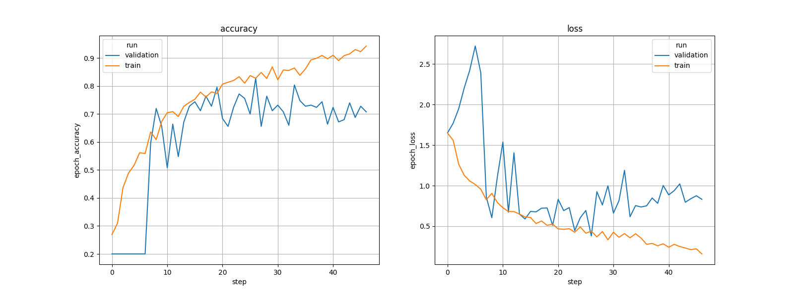

# Model, dataset and training

Back to the [README](../README.md).

## The model

The network is a MobileNetV1 with width factor 0.25 (depthwise separable convolutions), trained with the ST Model Zoo and quantised after training.

- Input: 96×96×3, RGB, uint8 (0 to 255). The quantisation parameters of the input are scale 1/127.5 and zero point 127, so the firmware passes the raw pixel values.
- Output: five softmax probabilities for the classes `count_0` to `count_4`, as float32.
- Size: 211,621 parameters and 7,550,858 multiply-accumulate operations per inference.
- Memory: the weights take 219,844 B (214.7 KiB) of flash and the activations 41,152 B (40.2 KiB) of RAM. With the X-CUBE-AI runtime the totals are 285,355 B (about 279 KiB) of flash and 57,876 B (about 57 KiB) of RAM.

### Preprocessing

The firmware (`tinyml_preprocess.c`) stretches the whole frame to 96×96 with nearest neighbour and an integer floor mapping, without padding:

```c
sx = ox * src_width  / 96;   // integer floor, no rounding
sy = oy * src_height / 96;
```

`ml_training/Model/user_config.yaml` uses `interpolation: nearest`, `color_mode: rgb` and `aspect_ratio: fit`. In the Model Zoo, `fit` resizes the image to the target size and distorts it if the aspect ratio differs. It does not letterbox. The other valid values are `crop` and `padding` (black borders), and `stretch` is not valid. So `fit` in training matches what the firmware does.

Settings that went wrong in earlier attempts: `input_shape: (48, 48, 1)` instead of `(96, 96, 3)`, `color_mode: grayscale` instead of `rgb`, `aspect_ratio: crop` or `padding` instead of `fit` (training would see cropped or bordered images while the chip stretches the full frame), and `board: STM32H747I-DISCO` instead of `NUCLEO-H743ZI2` (wrong benchmark target).

## Training results

The run is `2026_06_27_20_08_38`, with the Model Zoo chain `chain_tqe` (train, quantise, evaluate). This is the model that is flashed on the board: the weight tensors of the .tflite file were compared byte by byte with `X-CUBE-AI/App/network_data_params.c` (four 24-byte windows per tensor, all found), and `network_generate_report.txt` names this run folder.

| Metric | Value |
|---|---|
| Float model on the validation set | 82.8 % (207 of 250 images) |
| Quantised (uint8) model on the validation set | 82.4 % (206 of 250 images) |
| Best validation accuracy during training | 82.8 % (epoch 26; epoch 33 reached 80.4 %) |
| Validation accuracy in the last epoch | 70.8 % (epoch 46) |
| Median validation accuracy, epochs 20 to 46 | 72.4 % (range 65.6 % to 82.8 %) |
| Training accuracy, last epoch | 94.3 % (with augmentation) |
| Epochs | 47 logged (0 to 46, up to 100 configured, early stopping with patience 20) |
| Training time | 996 s (21.2 s per epoch) |
| Learning rate | 1e-3, then 5e-4 (epoch 35), then 2.5e-4 (epoch 43) |



The validation accuracy jumps by up to 10 points between epochs, and 82.8 % is a single peak. With `restore_best_weights: true` the weights of that epoch are restored (the Model Zoo log reports 82.8 % for the float model, not the 70.8 % of the last epoch, so the restored weights were evaluated). The same 250 images chose the checkpoint and report the result, so 82.4 % is an optimistic estimate for new frames. All validation accuracies in `train_metrics.csv` are multiples of 1/250, which is how the number of images was derived (the dataset is not in the repository). The gap to the training accuracy of 94.3 % shows that the model overfits the small dataset.

### Evaluation on the validation set

I computed this with a numpy re-implementation of the network, which has since been replaced by `ml_training/src/evaluate.py`. It gave 82.0 % on the 250 validation images (the Model Zoo log says 82.4 %). The rows are the true class, the columns the predicted one:

| true \ predicted | 0 | 1 | 2 | 3 | 4 |
|---|---|---|---|---|---|
| 0 | 50 | 0 | 0 | 0 | 0 |
| 1 | 0 | 45 | 5 | 0 | 0 |
| 2 | 0 | 7 | 38 | 5 | 0 |
| 3 | 0 | 0 | 5 | 29 | 16 |
| 4 | 0 | 0 | 0 | 7 | 43 |

On the first 60 training images per class the accuracy is 94.0 %. Variants of the validation images: RGB565 expansion rounded down as in the firmware 82.0 %, squeezed to 320×240 first 80.4 %, 30 % darker 79.6 %, 30 % brighter 76.0 %. The numpy version was not bit-exact to the TFLite kernels, but on 30 synthetic images it and the TFLite runtime gave the same predictions. With `evaluate.py` and the real runtime the numbers can differ a little.

The images show blue screw terminals on a light background. For other scenes (a room, black, uniform or noisy images) the model answers `count_0` or `count_4` with about 99 %, so a count from such an image means nothing.

The training and the firmware use the same preprocessing: full-frame stretch, nearest neighbour, RGB. The exact pixel mapping of TensorFlow's nearest resize and of the firmware's integer floor mapping was not compared.

### X-CUBE-AI analysis

From `network_generate_report.txt`: the 27 convolution layers (14 standard layers including the 1×1 pointwise ones and 13 depthwise layers) take 99.2 % of the operations. The input conversion (uint8 to int8) takes 0.7 %, global average pooling, the dense layer and softmax 0.05 %, and the output conversion to float32 less than 0.01 %.

## Dataset

The dataset was captured with the dashboard, using the camera and the objects of the final setup:

1. Connect the board, open the Dataset group on the Dashboard tab, choose the split (`train` or `val`) and the label (`count_0` to `count_4`).
2. Press Capture N frames. The dashboard takes the snapshots and saves them as PNG files.
3. Collect at least 100 training and 20 validation images per class, with different lighting and small changes of the position. The same image must not be in both splits, and the labels have to be exact; a wrong label hurts more than a small dataset.

With "Force RGB / QVGA" ticked the PNGs are 320×240 (otherwise the dashboard saves JPEG frames). The dataset of the deployed model consists of 480×272 PNGs (WQVGA). The firmware stretches every frame to 96×96, so both sizes work, but 480×272 matches the training images, and that is what Snap + TM RUN in the dashboard captures.

## Training

1. In `ml_training/Model/user_config.yaml`, replace the `<path-to-dataset>` placeholders (`training_path`, `validation_path`, `quantization_path`) with the absolute path of your dataset folder. The important preprocessing settings are the ones described above (`interpolation: nearest`, `aspect_ratio: fit`, `color_mode: rgb`); the model is `mobilenetv1_a025`, trained for up to 100 epochs with batch size 16.

2. Clone the ST Model Zoo once. It has no `setup.py` or `pyproject.toml`, so `pip install -e` does not work. Use a separate virtual environment, because its pinned versions (for example of TensorFlow) differ from this repository's `requirements.txt`.

   ```bash
   cd ml_training/Model
   git clone https://github.com/STMicroelectronics/stm32ai-modelzoo-services --depth 1
   cd stm32ai-modelzoo-services
   pip install -r requirements.txt
   ```

3. Train and quantise from the `image_classification` folder (`stm32ai_main.py` is there, not in `tf/`):

   ```bash
   cd image_classification
   python stm32ai_main.py --config-path ../.. --config-name user_config.yaml
   ```

   Hydra resolves `--config-path` relative to the folder of `stm32ai_main.py`, so `../..` is `ml_training/Model`, where `user_config.yaml` is. An absolute path works as well. The output folder comes from `hydra: run: dir:` in the config. Started from `image_classification/`, the quantised model ends up in `tf/src/experiments_outputs/<timestamp>/quantized_models/quantized_model.tflite`.

4. Check the accuracy on the PC:

   ```bash
   python ml_training/src/evaluate.py \
       --model ml_training/Model/2026_06_27_20_08_38/quantized_models/quantized_model.tflite \
       --dataset <path-to-dataset> --split val
   ```

   It runs the model on every image of the split and prints the accuracy and the confusion matrix.

The firmware logs a hash of the model input (`TM_IN: hash=...`). The PNGs saved by the dashboard expand RGB565 to RGB888 with rounding, the firmware rounds down, so a hash computed on the PC from a saved PNG can differ slightly even when the resize is identical.
